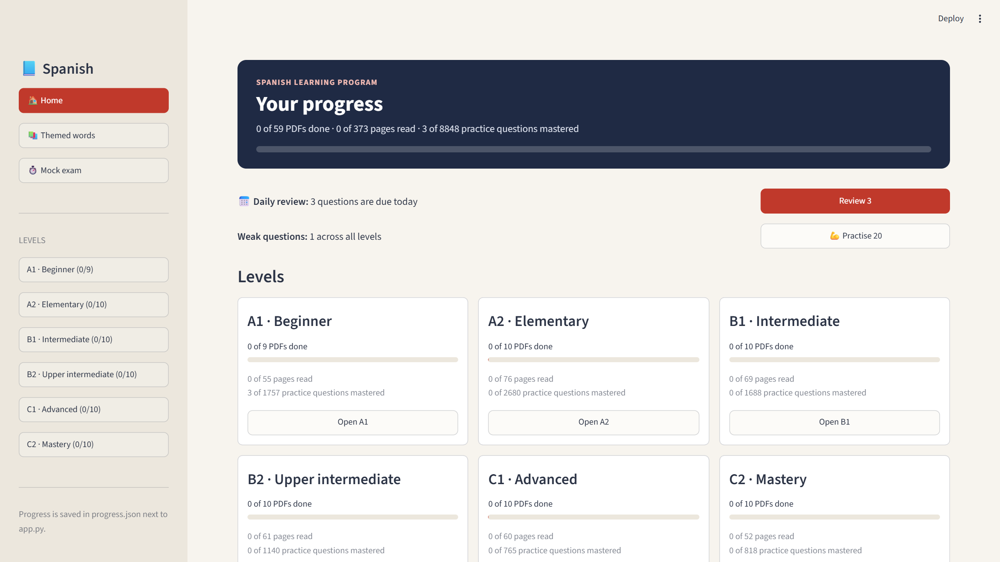
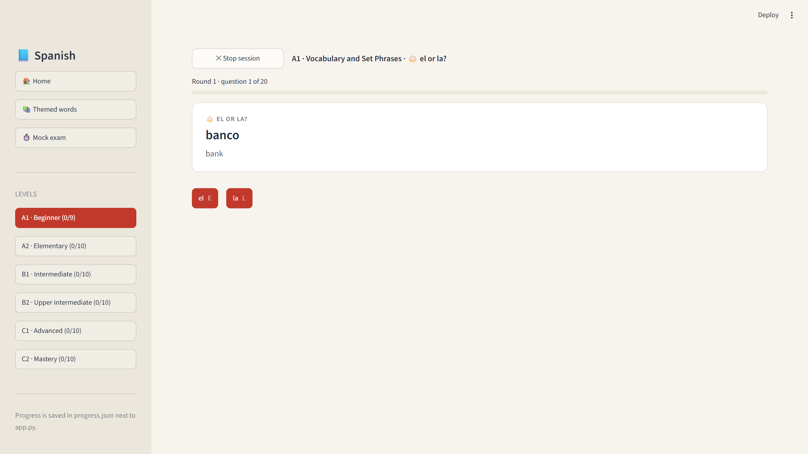
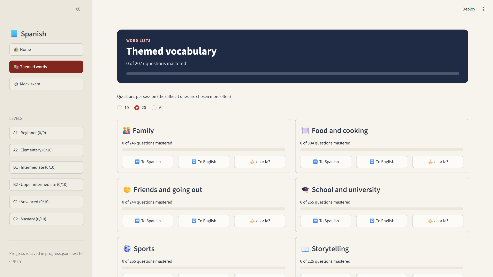

# Spanish Learning Program

A local study app for learning Spanish from Spain, from beginner level up to DELE C2. It combines
59 study PDFs with a reader, progress tracking and about 11,000 practice questions.

Built with Python and [Streamlit](https://streamlit.io) as my first GitHub project, while learning
Python. The study material was written by me together with Claude.



## What it does

**Read:** 59 PDFs (373 pages) across levels A1 to C2, sharp at any zoom, with the arrow keys to turn
pages. The app remembers where you stopped.

**Practise:** every PDF has its own practice session, with these exercise types where the PDF has
the material for them:

| Exercise | What you do |
|---|---|
| 📝 Grammar exercises | Type the missing part of a sentence |
| 🔤 Words | See the English, type the Spanish |
| 🔄 Words, Spanish to English | See the Spanish, type the English |
| ⚖️ el or la? | Choose the article of a noun, with the E and L keys |
| 🔁 Verb forms | Type the form for a given tense and person |
| 🎧 Listening | Hear a sentence, type what you hear |
| 🧩 Build the sentence | Click the words in the right order |
| 💬 Translate sentences | Type the whole sentence in Spanish |
| 🔍 Fix the mistake | Correct a wrong sentence and see why it was wrong |
| 🎯 Mixed test | All of the above mixed together |

**Remember it:**

- **Rounds:** you see everything once, then only what you got wrong until all of it is correct, and
  then the same again for what you missed the first time.
- **Daily review:** questions come back after 1, 3, 7 and 30 days, and a wrong answer brings a
  question back the next day.
- **Weak questions:** what you often get wrong is chosen more often and can be practised separately.

**Also included:** eight themed word lists (work, school, sports, friends, storytelling, travel, food,
family) and a timed mock exam. The mock exam trains exam pressure, but it does not follow the format
of the official DELE exam.

| | |
|---|---|
|  |  |

### How answers are graded

| What differs from the correct answer | Result |
|---|---|
| ñ written as n, capital letters, ¿ ? ¡ ! | 🟡 Warning, still counts as correct |
| Missing el / la in vocabulary | 🟡 Warning that names the article |
| Missing accent, outside verb forms | 🟡 Warning, still counts as correct |
| Dots and similar punctuation | 🟢 Ignored |
| Missing accent in a verb form (hablo, habló) | 🔴 Wrong |

Two exceptions: in "Fix the mistake", the exact thing that is the mistake has to be corrected, and in
the two PDFs about accents, accents have to be right. Spanish often allows several correct sentences,
so a wrong answer has an "I was actually right" button.

## Run it

Windows only. You need [Python 3.11 or newer](https://www.python.org/downloads/); tick "Add python.exe
to PATH" while installing.

1. Download this project and open its folder.
2. Double-click `start.bat`. The first run installs the packages, which takes about a minute.
3. Your browser opens at http://localhost:8501.

Everything runs on your own computer. Listening needs a Spanish (Spain) voice in your browser, which
Edge and Chrome normally have. If the app warns that it is missing, go to Windows Settings, Time &
language, Speech, Manage voices, Add voices, Spanish (Spain), and restart your browser.

Your results are saved in `progress.json` and `practice.json`. Git leaves these two files out on
purpose, so copy them somewhere safe to back them up.

## How the code is organised

| File | What it does |
|---|---|
| `app.py` | Home screen, level screens and the PDF reader |
| `practice_items.py` | Turns the PDF source data into questions |
| `practice_logic.py` | Checks answers, runs the rounds, chooses the questions |
| `practice_store.py` | Saves results and schedules the daily review |
| `practice_screen.py` | The practice screens |
| `extra_screens.py` | The themed word lists and the mock exam |
| `ui.py` | Small pieces shared between the screens |
| `build_catalog.py` | Rebuilds `data/catalog.json`, only needed after adding PDFs |
| `test_practice.py` | Checks all questions and rules |
| `data/content/` | The source data of each PDF, including the exercises |
| `data/themes/` | The themed word lists; add a file here to add a theme |
| `static/pdfs/` | The 59 PDFs |

To check that everything still works after a change:

```
.venv\Scripts\python.exe test_practice.py
```
